## Capstone Project
## Research RAG Assistant Final Report

### 1.  Problem: 
The growing volume of scientific publications makes it increasingly difficult for researchers, students, and professionals to efficiently find and extract relevant information. Traditional keyword-based search engines often require users to manually review multiple papers, while standalone large language models (LLMs) can generate inaccurate or outdated information due to limited access to current research.

### Proposed Solution:
This project develops a Retrieval-Augmented Generation (RAG) system that retrieves relevant scientific articles from arXiv and uses a locally hosted Llama 3.2 language model to generate context-aware answers to user questions. The system focuses on scientific domains such as physics, computer science, mathematics, statistics, electrical engineering, economics, and quantitative finance.

### 2. Model Outcomes or Predictions:
The proposed Retrieval-Augmented Generation (RAG) system combines classification, semantic similarity-based retrieval, and generative AI rather than relying on a traditional classification or regression model alone. The project primarily uses pretrained models, rather than training new models from scratch.
The primary objective is to generate relevant, informative, and context-grounded answers to scientific questions while reducing hallucinations compared with a language model operating without retrieved context. The system's performance can be evaluated using retrieval relevance, answer correctness, faithfulness to source material, and response latency.

### 3. Data Acquisition:
The data source is arXiv, an open-access repository containing research papers across multiple scientific disciplines. I use the Selenium web driver to search and retrieve relevant articles from arXiv web pages. For the EDA analysis, I have pre-downloaded 100 articles and broken them down into chunks using the same chunking algorithm as in the system. Below is the visualization of the word count of the raw unprocessed data:  
   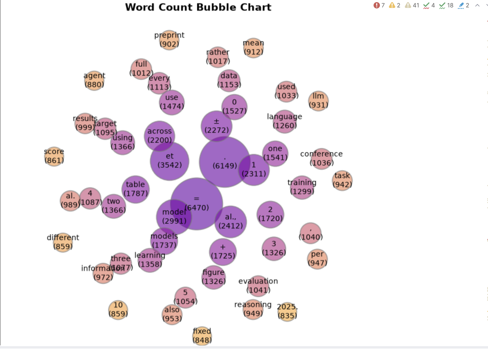
### 4. Data Preprocessing/Preparation:  
   a) PDF text extraction: Extracts research content from downloaded scientific papers.  
   b) Text chunking: Divides extracted content into smaller passages with 20% overlap. I am using basic chunking technique, cutting the passages by a fixed size.  
   c) Encoding. I use the CrossEncoder library for ranking the article titles.  
   d) Relevance filtering. Selecting passages most relevant to the user's question to reduce irrelevant context. 
Below is the visualisation of chunk distribution per article: 
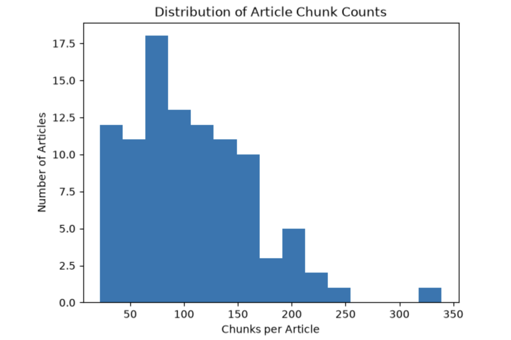
### 5. Modeling:
#### Hyperparameter Tuning and Validation Strategy
Due to limited computational resources and time constraints, exhaustive Grid Search and traditional k-fold cross-validation were not performed. Instead, I used targeted experiments and component-level evaluations to select models and configurations for the RAG pipeline.
- **Model comparison:** I compared Qwen (`qwen3:8b`) and Llama (`llama3.2:3b`) for question classification, evaluating accuracy, precision, recall, and inference latency.
- **Prompt engineering and threshold testing:** I improved Llama's classification performance by switching from binary decisions to relevance scores between 0 and 1, then comparing different decision thresholds.
- **Query generation evaluation:** I compared query generation approaches using semantic similarity to the original question, article-finding performance, and latency.
- **Retrieval strategy comparison:** I evaluated cross-encoder-only retrieval against a two-stage bi-encoder and cross-encoder approach, comparing Precision@10, Recall@10, and latency.
- **End-to-end evaluation:** I tested the selected RAG configuration on 150 valid scientific questions, assessing answer relevance, faithfulness, and response latency.
Numerical parameters, including chunk size, chunk overlap, and the number of retrieved candidates, were chosen using general RAG recommendations and the available computational resources rather than exhaustive parameter optimization.
These targeted comparisons do not replace Grid Search or cross-validation, and the results may depend on the particular evaluation questions used. Nevertheless, they helped identify performance bottlenecks and guided model and retrieval architecture choices. Future work could evaluate parameter combinations more systematically and use multiple evaluation splits to assess result stability and generalizability.

The architecture of my system has several stages. 
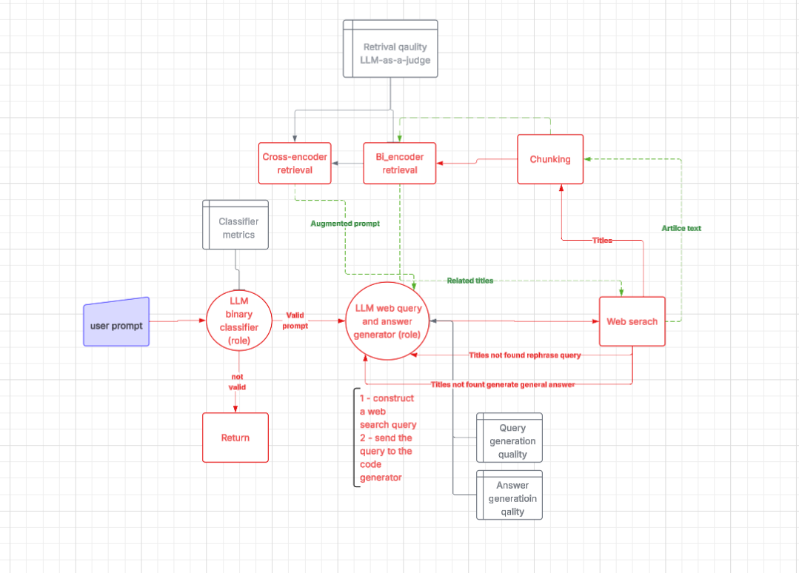
At almost each stage I have evaluated and compared performance of different models and chosen the most appropriate one for the purpose of the project.  

**LLM Classifier.** 

An LLM-based classifier is used to filter out questions that fall outside the system’s supported scientific domains.
Initially, I configured two models, Qwen (qwen3:8b) and Llama (llama3.2:3b), to perform binary classification. While Qwen demonstrated strong performance, the smaller and faster Llama model produced significantly worse results.
To improve Llama's performance, I applied prompt engineering techniques, changing the classification approach from a binary decision to a relevance score ranging from 0 to 1. I then experimented with different classification thresholds and evaluated accuracy, precision, and recall.
By optimizing the prompt and adjusting the classification threshold, I significantly improved Llama's performance, achieving results close to those of the larger Qwen model while retaining the advantage of faster inference.
The following visualizations illustrate the model comparison and the impact of threshold adjustments on classification performance.
   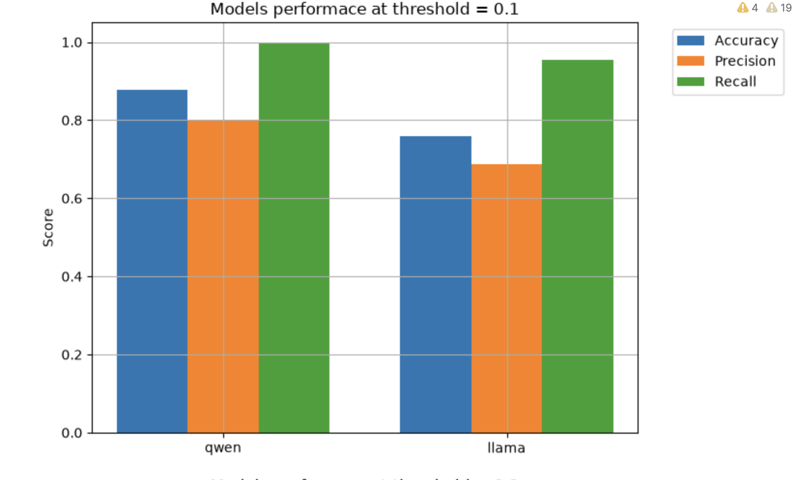
   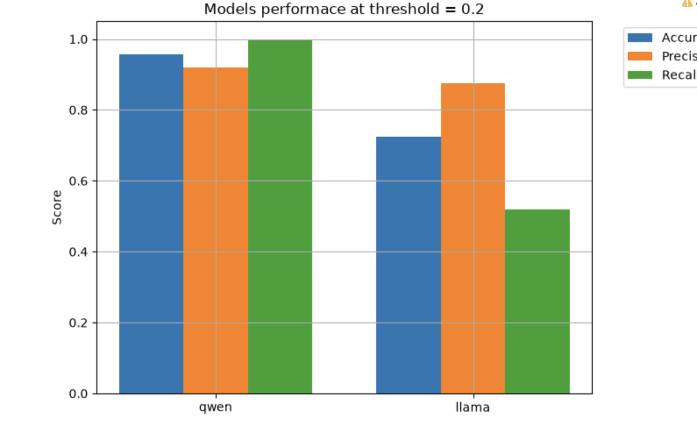

In terms of latency, Llama 3.2 demonstrated significantly lower response times.   
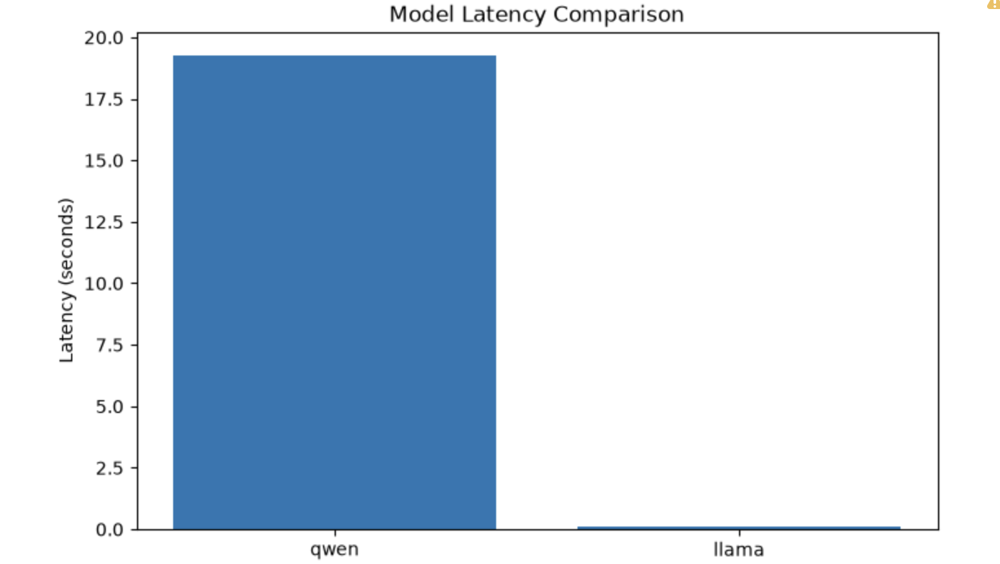
Since my model has many bottlenecks, I have decided to choose Llama as my classification model after testing it with different other parameters.  

**Web query generator.**

The RAG system expects a user to send casually formulated prompts which on their own cannot be used for web search. An LLM model captures the semantic essence of the query and rephrases it to increase the likelihood of finding related articles on the arXiv web page. Here is the table with the acquired comparison results.  
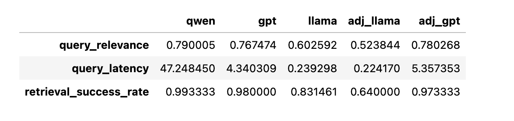
Since, the Llama with default parameters shows significantly shorter latency and slightly lower scores on relevancy to the original prompt and title findings rate compared to toher models, I decided to proceed with Llama for this task.  

**Retrieval part.** 

After the related articles are downloaded and chunked, the system has to select the most relevant chunks for answering the question. I have compared two approaches: using cross encoder only and preprocessing the chunks with Bi-encoder and then sending the selected by the Bi encoder candidates to the Cross Encoder. The second approach has improved the process at all metrics.   
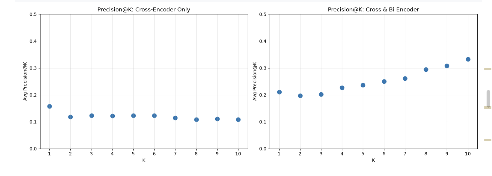  
In the graph above, we can see that adding the Bi-encoder improved the average precision at 10 chunks up to 30%.  
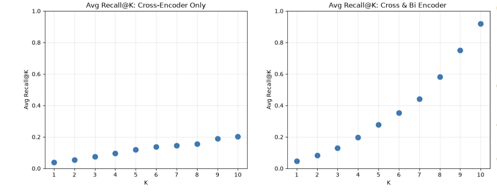
The improvement in average recall was even more substantial. Incorporating the bi-encoder increased Recall@10 from approximately 20% to 90%, representing a 70-percentage-point improvement.
From a user's perspective, this means the system can identify a much larger proportion of relevant scientific text passages among the top 10 retrieved chunks. As a result, the language model has access to more relevant information when generating answers, potentially improving answer completeness and reducing the risk of missing important research findings.
Additionally, the two-stage retrieval approach reduced retrieval latency by almost half, allowing users to access relevant scientific information more quickly.
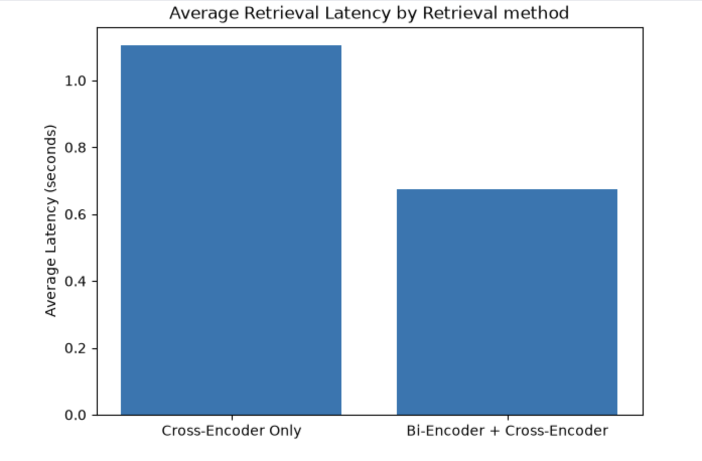

**Answer generation.**  

I have not performed comparative analysis for the answer generation since it would require more computation power than I have. But I have chosen the LLama model with default parameters for this stage.

### 6. Model Evaluation:

I was using two layered evaluations: 1 component-level and system-level. I utilized ChatGPT for creating questions a user might ask: 150 of them were valid questions (related to the selected topics) and 150 invalid. This is an example of the test data:  
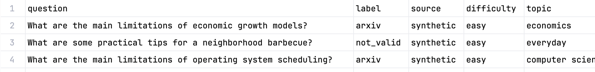 
Below the confusion matrix for this data of the selected classifier model (LLama) is demonstrated:   
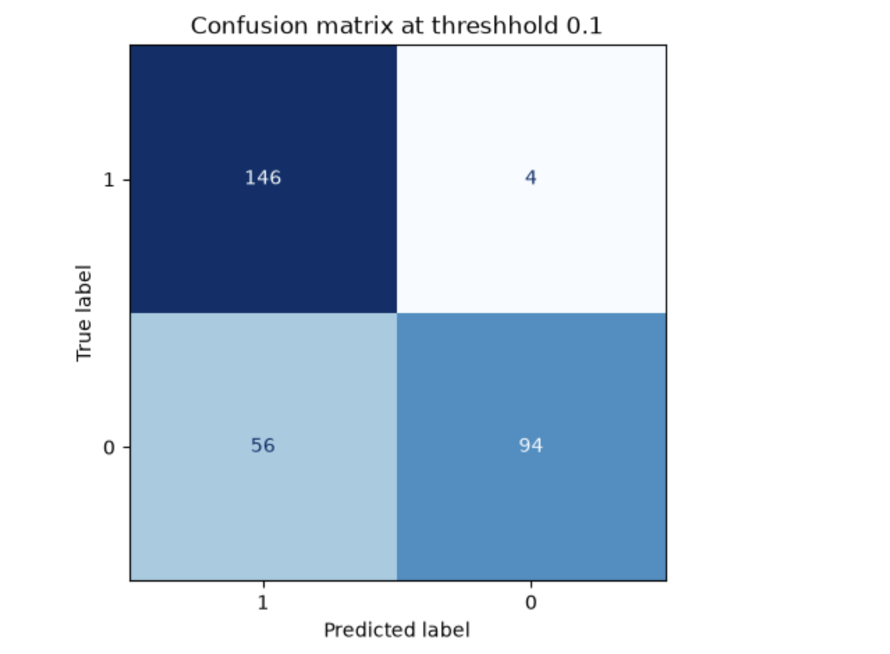 
For evaluating generated web query relevance to the original prompt, SentenceTransformer("all-MiniLM-L6-v2") was used. It calculated the cosine similarity between the original prompt and the generated query. 

For retrieval testing, I fed all the retrieved chunks to ChatGPT and prompted it to rank according to the original user question. I used this data to perform the retrieval evaluation. 

 I was limited in the computational resources for performing a comprehensive system-level evaluation, so I have limited it to two metrics: relevance and faithfulness. Relevance measures how well generated answers address users’ questions.  And faithfulness measures how well the generated answers are grounded in the provided context. Other metrics like toxicity, in my opinion, in the case of my system are less important, since the model is limited by the provided context. Below is the screenshot of the parameters that I was using for evaluation.  
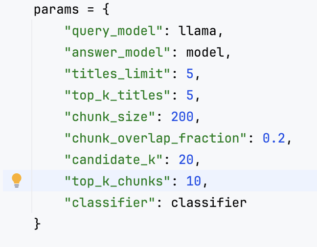 


`query\_model` is the selected model for the web query generation (default Llama)  

`answer\_model` is the selected model for the answer generation (default Llama)  

`titles\_limit` is the maximum number of the titles we extract from the arXiv web page.  

`top\_k\_titles` is the maximum article titles we select out of pulled ones from the webpage.   

`chunk\_size` is the number of words in each chunk.  

`chunk\_overlap\_fraction` is the proportion of the chunk that overlaps to preserve some context while cutting and separating the same body of text.  

`candidate\_k` the number of chunks the bi-encoder retrieves as relevant to the original prompt.   

`top\_k\_chunks` is the number of chunks cross encoder selected out of the pull of candidates.   

`classifier` is the LLM model that guards the system from irrelevant prompts.  

To evaluate relevance and faithfulness I was using the deepeval library and Llama as an LLM-as-a-judge. 

Although using the same model for both answer generation and evaluation is not ideal due to potential evaluation bias, I decided that a lightweight model was the most practical choice, given the computational cost and time required for evaluation.
Below is the graph that represents the relevance distribution with the given parameters:   
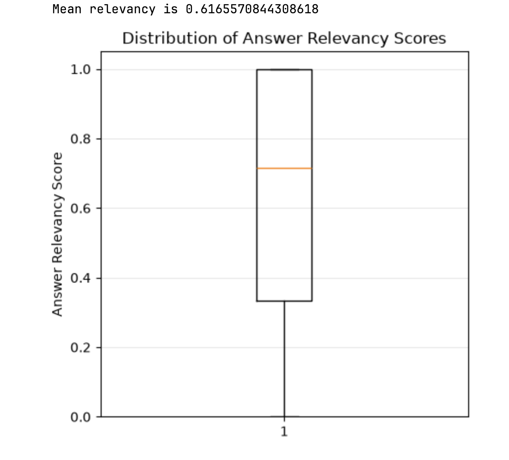 
As shown in the boxplot above, the median relevance score assigned by the GPT-based judge model is approximately 0.7. Additionally, 75% of the generated answers received relevance scores of 0.35 or higher. I consider these results acceptable for this stage of the system's development.

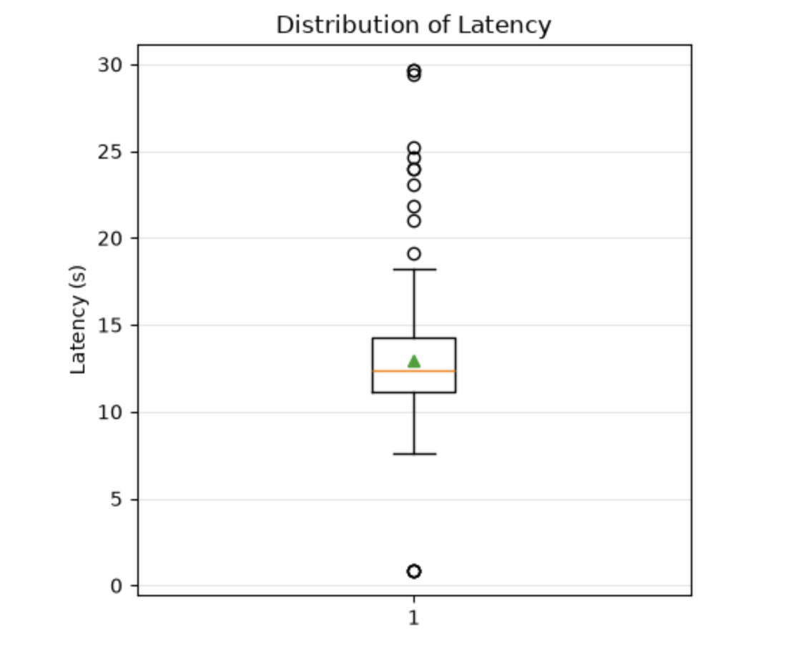
Above is the visualization of the full system latency for the dataset of 150 valid questions. Although I was using only “arXiv” labeled questions, my system still has filtered some out as irrelevant to the allowed topics, those filtered out questions are shown as outliers on the short side.  The median, as we can see, is approximately 12 ses.   
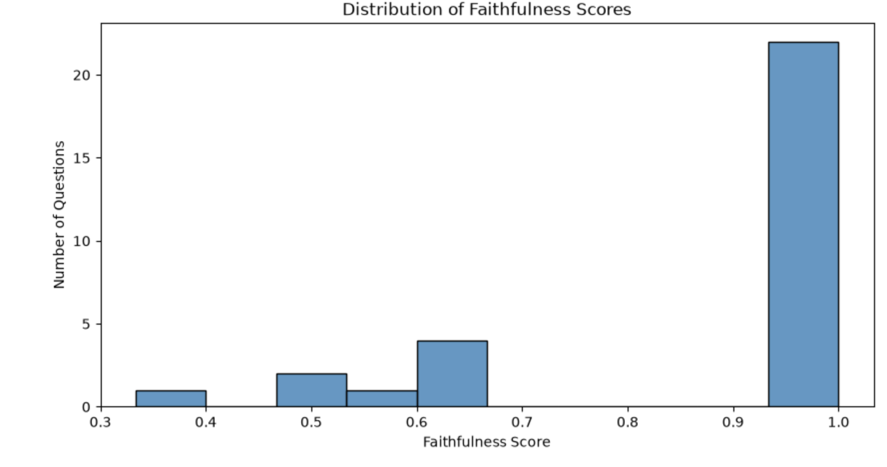
As it is shown on the graph above, the majority of answers were marked as pretty well grounded.  
I have examined the examples of the low scores on faithfulness questions and answers, here is one of them:  
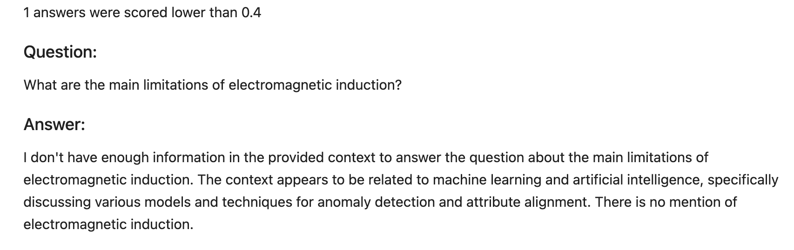 

As we can see the system with the current prompt is very restricted. Ideally, the system would allow users to adjust the level of strictness when generating responses.

## Project Structure

The repository is organized into the following components:

```text
scientific_article_RAG/
├── component_level_eval/
├── full_eval/
├── images/
├── .dockerignore
├── .gitignore
├── ArxivSearch.py
├── Dockerfile
├── RAG_STARTUP_GUIDE.md
├── README.md
├── app.py
├── arxiv_research_assistant_eda.ipynb
├── eval.py
├── main.py
├── model.py
├── prompts.py
├── questions-answers.csv
├── rag_flow.py
├── rag_logs.csv
└── requirements.txt
```
`component_level_eval/` — Experiments and evaluations of individual RAG components, including model comparisons and retrieval performance.
`full_eval/` — End-to-end system evaluation, including answer relevance, faithfulness, and latency.
`images/` — Visualizations, charts, and figures used in the project report.
`arxiv_research_assistant_eda.ipynb `— Exploratory data analysis of scientific articles and text chunks.
`ArxivSearch.py` — Scientific article search and retrieval from arXiv.
`model.py` — Language model configuration and initialization.
`rag_flow.py` — Implementation of the RAG workflow.
`prompts.py` — System promts for classification, query generation, and answer generation.
`main.py` — FastAPI backend and API endpoints.
`app.py` — Gradio user interface.
`eval.py `— Evaluation utilities.
`questions-answers.csv` — Dataset of questions and answers used for evaluation.
`Dockerfile `— Docker configuration for the backend.
`requirements.txt` — Python dependencies.
`RAG_STARTUP_GUIDE.md` — Instructions for running the application.
`.deepeval/` — DeepEval evaluation artifacts and configuration.
`.gitignore / .dockerignore` — File exclusion configurations for Git and Docker.

## Jupyter Notebooks
The following notebooks document the data analysis,
model experiments, and evaluation conducted throughout
the project.
### Exploratory Data Analysis
- [Data Exploration](arxiv_research_assistant_eda.ipynb) —
  Analysis of scientific articles, text lengths,
  and chunk distributions.

### Component-Level Evaluation
- [Classifier Evaluation](component_level_eval/classifier_eval.ipynb) —
  Comparison of Llama and Qwen classification performance.
- [Retrieval Evaluation](component_level_eval/retrieval_eval.ipynb) —
  Comparison of retrieval strategies using precision,
  recall, and latency.
- [Query Generation ](component_level_eval/web_query_generation_eval.ipynb) —
  Query generation evaluation.

### End-to-End Evaluation
- [Faithfulness evaluation](component_level_eval/web_query_generation_eval.ipynb) —
  Evaluation of answer faithfulness.
- [Faithfulness evaluation](full_eval/relevancy_eval.ipynb) —
  Evaluation of answer faithfulness,
  and system latency.